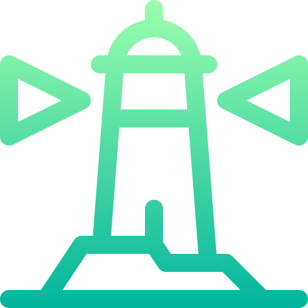

<!-- PROJECT SHIELDS -->

[![Contributors][contributors-shield]][contributors-url]
[![Forks][forks-shield]][forks-url]
[![Stargazers][stars-shield]][stars-url]
[![Issues][issues-shield]][issues-url]
[![Unlicense License][license-shield]][license-url]
[![LinkedIn][linkedin-shield]][linkedin-url]

<!-- PROJECT LOGO -->

<br />
<div align="center">
  <a href="https://github.com/llamp-ai/llamphouse">
    
  </a>

<h3 align="center">LLAMPHouse</h3>

<p align="center">
    Serving Your LLM Apps, Scalable and Reliable.
    <br />
    <a href="https://github.com/llamp-ai/llamphouse/tree/main/docs"><strong>Explore the docs »</strong></a>
    <br />
    <br />
    <a href="#quickstart">Quickstart</a>
    ·
    <a href="https://github.com/llamp-ai/llamphouse/issues/new?labels=bug&template=bug-report---.md">Report Bug</a>
    ·
    <a href="https://github.com/llamp-ai/llamphouse/issues/new?labels=enhancement&template=feature-request---.md">Request Feature</a>
  </p>
</div>

---

## What is llamphouse?

llamphouse is a runtime for agents. You write an agent as a Python class; llamphouse keeps its conversations,
runs it on workers, carries it through waits, crashes and deploys, serves it over HTTP and other protocols, and
shows you what it did. It doesn't call models and has no opinion about which one you use: a model call is your
code, inside your agent.

> [!NOTE]
> This branch is **llamphouse 2.0** (`2.0.0a0`, an alpha: the API may still change). Coming from 1.x? See
> [Migrating from 1.x](docs/migrating-from-1x.md) - `llamphouse migrate` brings a 1.x database's conversations
> over, and the Assistants API adapter keeps 1.x clients working.

- **Threads and runs** - everything is a thread with one agent, at most one active run at a time, and every
  message, state change and run event recorded on it in order.
- **Durable runs** - a run waits for an answer, a timer, a signal or other agents without holding a worker,
  and survives a crash or a deploy: it replays what it recorded and carries on. Nothing recorded happens twice.
- **Working with others** - fork your own thread to work in parallel, call other agents, hand a conversation over.
- **Protocols** - a native HTTP API (`/v2`) with live streams, plus OpenAI Responses (and Conversations),
  the OpenAI Assistants API, A2A v1.0 and AG-UI, all on the same threads and runs.
- **Compass** - a web app at `/compass` to see, debug and learn: why a run waits, its story, steps, state,
  session, trace; dashboards on your data.
- **Operations** - triggers (webhooks, schedules), external subscribers, auth (API keys, OIDC, tenants),
  config changed at runtime, tracing (OpenTelemetry), Postgres + Redis with Alembic migrations, and every
  component swappable.

## Quickstart

```bash
pip install "llamphouse==2.0.0a0"
```

```python
# agents.py
from llamphouse.sdk import Agent


class Greeter(Agent):
    """Greets you, and remembers your name."""

    async def run(self, ctx) -> None:
        name = await ctx.state.get("name")
        if name is None:
            name = (await ctx.ask("What's your name?")).text  # waits, holding no worker
            await ctx.state.set("name", name)
        await ctx.send(f"Hello, {name}! You said: {ctx.input.text}")
```

```yaml
# agents.yaml
apiVersion: llamphouse.io/v1alpha1
kind: Agent
metadata: {name: greeter}
spec:
  entrypoint: agents.py:Greeter
```

```bash
llamphouse up --memory --agents agents.yaml          # http://127.0.0.1:8000/compass

curl -s -X POST localhost:8000/v2/runs -H 'Content-Type: application/json' \
     -d '{"agent": "greeter", "text": "hi"}'          # a thread and its first run
```

The run asks a question and waits; answer it with `POST /v2/runs/{id}/answer` (or in Compass) and it carries
on where it stopped. For a model, see [Adding an LLM](docs/getting-started/adding-llm.md): your own client
(e.g. the OpenAI Responses API), streamed into the run with `llamphouse.helpers.streams`.

## In production

```bash
llamphouse db upgrade --config llamphouse.yaml                                   # the schema (Alembic)
llamphouse up --role api    --config llamphouse.yaml --agents agents.yaml        # as many as you like
llamphouse up --role worker --config llamphouse.yaml --agents agents.yaml        # as many as you like
```

`llamphouse.yaml` (the runtime file) says where things live - `data_store: {postgres: ...}`,
`run_queue: {redis: ...}`, adapters, auth, tracing - and agent files say what the agents are. See
[Configuration](docs/configuration.md), [Deployment](docs/deployment.md) and [examples/10_Server](examples/10_Server).

## Learn more

- [Docs](docs/index.md): concepts (threads and runs, the run context, state, sessions, durable runs, working
  with other agents), guides (streaming, tool calls, LangGraph, config, files, triggers, subscriptions,
  adapters, auth, tracing, Compass), the [HTTP API](docs/http-api.md).
- [Examples](examples/): 19 of them, from a hello world to a coding agent that forks itself.
- [Changelog](CHANGELOG.md).

## Development

```bash
git clone https://github.com/llamp-ai/llamphouse.git && cd llamphouse
uv sync                                   # the package, its extras and the dev tools
uv run pytest tests                       # everything in memory
LLAMPHOUSE_TEST_POSTGRES=postgresql://... LLAMPHOUSE_SCENARIO_STORE=postgres LLAMPHOUSE_SCENARIO_SPLIT=1 \
  uv run pytest tests/unit/runtime        # on Postgres, runs executing in a second engine
```

See [Contributing](docs/contributing.md).

## Contributing

Contributions are welcome: open an issue, or fork the repo and open a pull request.

### Top contributors:

<a href="https://github.com/llamp-ai/llamphouse/graphs/contributors">
  
</a>

## License

See [`LICENSE`](LICENSE) for more information.

## Contact

Project Admin: Pieter van der Deen — [pieter@stack-wise.co.uk](mailto:pieter@stack-wise.co.uk)

<!-- MARKDOWN LINKS & IMAGES -->

[contributors-shield]: https://img.shields.io/github/contributors/llamp-ai/llamphouse?style=for-the-badge
[contributors-url]: https://github.com/llamp-ai/llamphouse/graphs/contributors
[forks-shield]: https://img.shields.io/github/forks/llamp-ai/llamphouse?style=for-the-badge
[forks-url]: https://github.com/llamp-ai/llamphouse/network/members
[stars-shield]: https://img.shields.io/github/stars/llamp-ai/llamphouse.svg?style=for-the-badge
[stars-url]: https://github.com/llamp-ai/llamphouse/stargazers
[issues-shield]: https://img.shields.io/github/issues/llamp-ai/llamphouse.svg?style=for-the-badge
[issues-url]: https://github.com/llamp-ai/llamphouse/issues
[license-shield]: https://img.shields.io/github/license/llamp-ai/llamphouse.svg?style=for-the-badge
[license-url]: https://github.com/llamp-ai/llamphouse/blob/master/LICENSE
[linkedin-shield]: https://img.shields.io/badge/-LinkedIn-black.svg?style=for-the-badge&logo=linkedin&colorB=555
[linkedin-url]: https://linkedin.com/in/pieter-vdd
